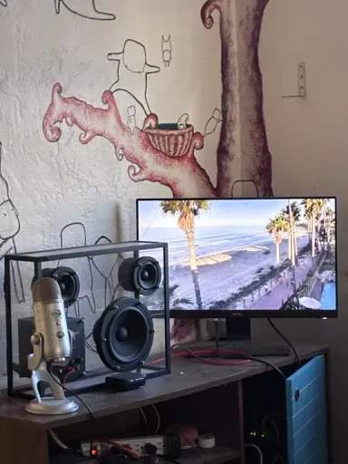
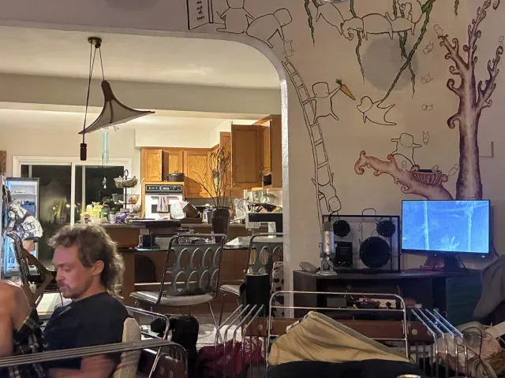

# surfcam
A setup for a machine to always have the pb surf cam up. I would frequently come home to dylan staring at his laptop watching the waves so i made it always there for him on the tv.



it flips through a bunch of cams fullscreen in mpv, 5 min each. pb, scripps pier underwater, la jolla shores, and some yosemite ones (half dome, el cap, high sierra). if a stream freezes or cant be found it just restarts and tries again every 30 seconds.

here you can see dylan so happy and on his phone



## how i found the stream url originally

1. first thing i did was go to https://hdontap.com/?utm_source=HDOnTap_Player&utm_medium=toolbar_logo&utm_campaign=customer_embed+pacificbeach_pacterrace-ingest01-hd1-CUST
2. when to f12 and then networking
3. searched m3u8 in the filter box
4. right clicked the blue link and clicked copy link.

5. Ran this command directly on the Orin AGX (which is already plugged into monitor:
   ```
   mpv --fullscreen --no-osc "https://live.hdontap.com/hls/hosb1/pacificbeach_pacterrace.stream/chunklist.m3u8?e=1780506661&eh=edge02.nginx.hdontap.com&t=ktza5dQS-uvq4deAih3eNQ"
   ```

   that link expires tho so now the script grabs a fresh one off the hdontap page every time.

## But here is how you use this script!

1. Clone the repo.
2. run python3 surfcam.py
3. if you run it from a terminal you get a menu. up/down to move, a to add a cam, d to delete, t to change how long each one stays up, enter to start, q to quit. you can click rows too
4. if you run it with no terminal (like on startup) it just starts playing. thats what display.txt is for:
   ```
   DISPLAY=:0 XAUTHORITY=/run/user/1000/gdm/Xauthority python3 /home/kile/dev/surfcam/surfcam.py
   ```

the cam list lives in streams.json if you wanna edit it by hand.
